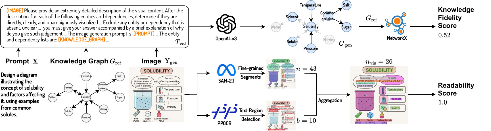

<h2 align="center">
  <b>MMMG: A Massive, Multidisciplinary, Multi-Tier Generation Benchmark for Text-to-Image Reasoning</b>

</h2>

Official evaluation toolkit for **MMMG**: the **M**assive **M**ulti-discipline **M**ulti-tier Knowledge-Image **G**eneration benchmark.

* ✨ **[Project Page](https://mmmgbench.github.io/)**
* 📄 **[Paper (arXiv 2506.10963)](https://arxiv.org/abs/2506.10963)**
* 💾 **[MMMG Dataset on HuggingFace](https://huggingface.co/datasets/MMMGBench/MMMG)**
* 📷 **[Sampled Results](https://huggingface.co/datasets/MMMGBench/MMMG_Result)**
* 📂 **[Training Set](https://huggingface.co/datasets/MMMGBench/MMMG_Train)**

---


## ✨ Overview


**MMMG** is a large-scale benchmark designed to assess text-to-image (T2I) models on their ability to generate *faithful* and *visually readable* images based on knowledge-intensive prompts, spanning multiple academic disciplines and educational levels.

**MMMG-Score** is computed as:

> **MMMG-Score = Knowledge Fidelity (1 - GED) × Visual Readability (SAM2.1)**

Where:

* **GED**: Graph Edit Distance between predicted and ground-truth concept graphs.
* **SAM2.1**: Visual readability score based on SAM2.1 segmentation accuracy.

---

## 📬 News
- **2025.11.29** We have benchmarked [Nano Banana Pro](https://blog.google/technology/ai/nano-banana-pro/), which is currently the leading model.
- **2025.9.19** Our work has been accepted by NeurIPS 2025!
- **2025.6.10** The repository has been updated.

---

## ♻️ Installation

```bash
git clone https://github.com/MMMGBench/MMMG.git
cd MMMG
conda env create -f environment.yaml
conda activate mmmg
```

---

## 📊 Dataset Preparation

Place your generated images under the following structure:

```
/data/
 ├─ preschool/
 ├─ primaryschool/
 ├─ secondaryschool/
 ├─ highschool/
 ├─ undergraduate/
 └─ PhD/
```

Each folder contains model-generated images named as `<prompt_key>.png`.

---

## 💡 Run Evaluation

We use the Azure OpenAI service for knowledge integrity evaluation. If you use a different API interface (e.g., from OpenAI website), please **modify**:

```bash
mmmg_eval/step1_knowledge_integrity.py
```

Insert your API keys into:

```bash
mmmg_eval/utils/gpt_api_pool.py
```

### Example: Evaluate GPT-4o Generations

```bash
python evaluate.py \
  --img_dir ./data/GPT-4o \
  --output_dir ./output \
  --sam2_ckpt /YOUR/PATH/TO/sam2/checkpoints/sam2.1_hiera_large.pt \
  --t2i_method GPT-4o \
  --api_name o3 \
  --hf_cache ./data/MMMG
```

### Arguments

* `--img_dir`: Path to generated images (organized by education tier).
* `--output_dir`: Where evaluation logs and scores will be saved.
* `--sam2_ckpt`: Path to the pretrained SAM2.1 checkpoint.
* `--t2i_method`: Name of the T2I model under evaluation.
* `--api_name`: LLM backend (e.g., `gpt-4`, `gpt-4o`, `o3`).
* `--hf_cache`: Path to HuggingFace cache for loading ground-truth graphs.

---

## 📅 Citation

If you find MMMG helpful in your research, please consider citing our paper:

```bibtex
@inproceedings{luo2025mmmg,
  title={Mmmg: A massive, multidisciplinary, multi-tier generation benchmark for text-to-image reasoning},
  author={Luo, Yuxuan and Yuan, Yuhui and Chen, Junwen and Cai, Haonan and Yue, Ziyi and Yang, Yuwei and Daha, Fatima Zohra and Li, Ji and Lian, Zhouhui},
  booktitle={The Thirty-ninth Annual Conference on Neural Information Processing Systems Datasets and Benchmarks Track},
  year={2025}
}
```
